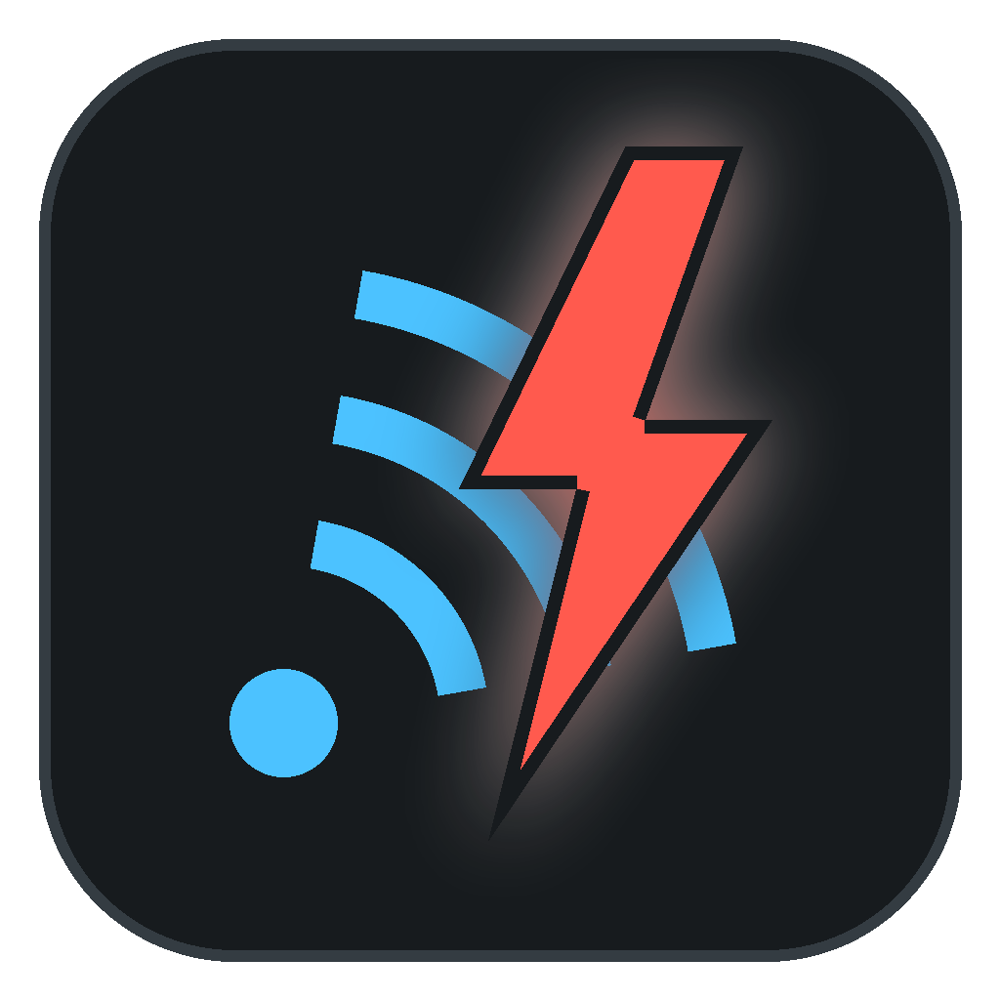
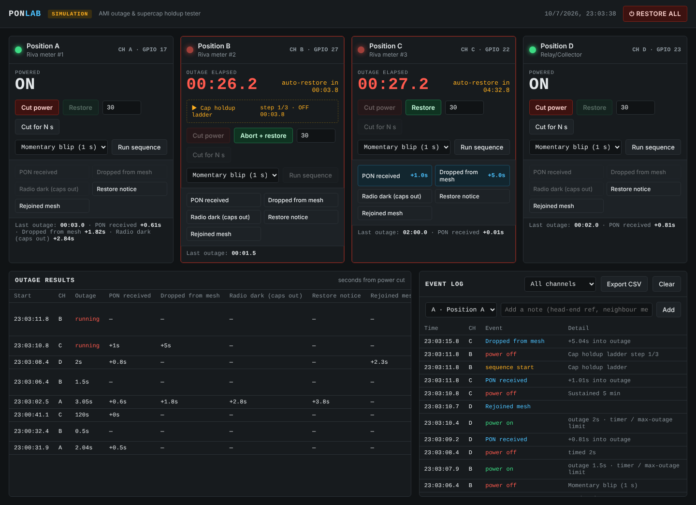
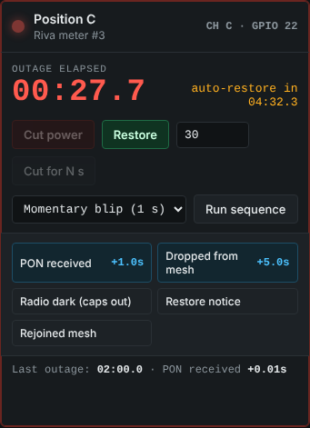
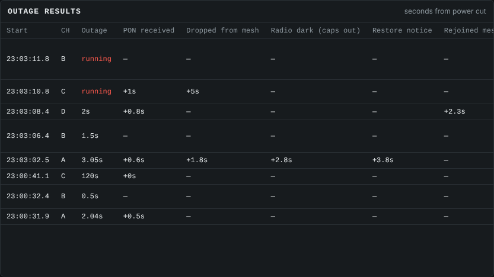
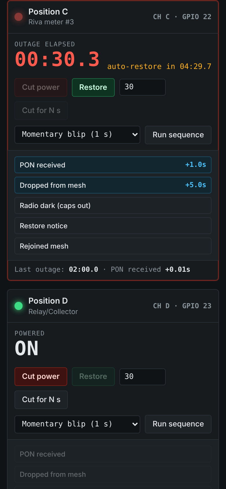

<p align="center"></p>

# PON Lab — AMI meter outage simulator

A Raspberry Pi web dashboard that cuts and restores line power to meters under
test through relays, so you can measure:

- **PON / last gasp** — how long after the cut the head-end sees the outage notice
- **Mesh survival** — how long the meter keeps routing for neighbours on cap power
- **Supercap holdup** — when the radio finally goes dark
- **Restore** — time to power-restore notice and rejoining the mesh



| Outage in progress | Results table | Phone view |
|---|---|---|
|  |  |  |

## Quick start

```bash
# copy the ponlab folder to the Pi, then:
cd ponlab
chmod +x install.sh
sudo ./install.sh
```

Open `http://<pi-ip>:8080` from any browser on the network.

Try it on any PC first (no relays needed):

```bash
pip install flask
PONLAB_SIM=1 python3 app.py     # http://localhost:8080
```

On Windows, double-click **Try PON Lab (simulation).bat**.

The header shows **SIMULATION** or **LIVE GPIO** so you always know which you're in.

## How to run a test

1. Cut power (manual, **Cut for N s**, or **Run sequence**).
2. Watch your head-end / collector / field tool. When something happens, hit the
   matching button on that channel: *PON received, Dropped from mesh, Radio dark,
   Restore notice, Rejoined mesh*. Each is stamped as seconds from the cut.
3. **Outage results** builds a table per outage; **Export CSV** gives you everything.

Built-in sequences (edit in `config.json`):

| Preset | What it checks |
|---|---|
| Momentary blip (1 s) | Meter should *not* send a PON for a blip (most are configured to delay) |
| Sustained 5 min | Full PON → mesh loss → caps out → restore cycle |
| Cap holdup ladder | 5 s → 5 min outages to find where routing/radio stops |
| Recloser (3 shots) | Reclosing pattern; checks PON suppression and restore behaviour |
| Flicker ×10 | Rapid cycling; checks for missed or duplicate notices |

## Wiring

```
Pi GPIO17 ─► relay board IN1   (B=27, C=22, D=23)
Pi 5V/GND ─► relay board VCC/GND

LINE ─► contactor COM ─► NC contact ─► meter socket line side
              ▲
     contactor coil driven by relay channel
```

- **Use the NC (normally-closed) contact** — `"wiring": "NC"` in config. Energizing
  the relay = outage. If the Pi crashes, reboots or loses power, the meter goes
  back on automatically.
- Most cheap relay boards are **active-low** (`"relay_active_high": false`). If a
  channel works backwards, flip that setting.
- `max_outage_seconds` (default 3600) is a hard limit enforced on the Pi — power is
  restored even if the browser is closed.
- **RESTORE ALL** in the header puts every channel back on.

### Optional automatic "caps out" detection

Set `sense_gpio` on a channel and wire an optocoupler or photo-sensor (e.g. on the
meter's display backlight or optical-port LED) so the input is pulled **low while
the meter is alive**. The dashboard logs *sense dark* the moment it drops — an
automatic holdup time with no stopwatch.

## Safety — please read

Meter sockets are on live service voltage (240 V split-phase, or more on
commercial forms) with high available fault current.

- Do **not** switch the meter through the small 10 A hobby relay contacts. Use
  the hobby relay to drive the coil of a **properly rated contactor** or a
  meter test switch, in an enclosure with fusing.
- Have the line-side wiring done by a qualified electrician / meter tech and test
  on a bench test board, not a customer service.
- Keep the Pi and relay board on the low-voltage side of a barrier.

## Files

- `app.py` — backend (Flask + gpiozero), watchdog, timers, sequences, logging
- `static/index.html` — the dashboard
- `config.json` — channels, GPIO pins, presets, mark buttons
- `data/events.jsonl` — permanent event log (survives restarts)
- `Try PON Lab (simulation).bat` / `try-sim.sh` — run with no hardware
- `install.sh` — installs packages and a systemd service that starts on boot
