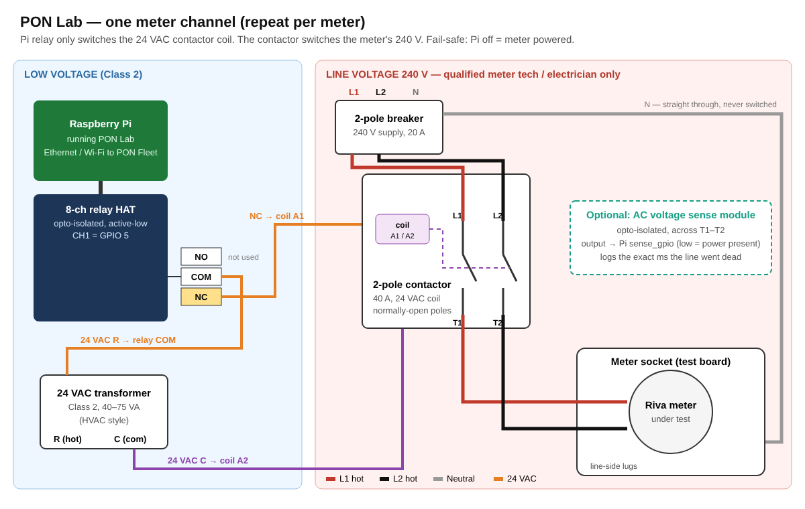

<p align="center"></p>

# PON Lab — AMI meter outage simulator

A Raspberry Pi web dashboard that cuts and restores line power to meters under
test through relays, so you can measure:

- **PON / last gasp** — how long after the cut the head-end sees the outage notice
- **Mesh survival** — how long the meter keeps routing for neighbours on cap power
- **Supercap holdup** — when the radio finally goes dark
- **Restore** — time to power-restore notice and rejoining the mesh


| Outage in progress | Results table | Phone view |
|---|---|---|
|  |  |  |

## Quick start

```bash
# copy the ponlab folder to the Pi, then:
cd ponlab
chmod +x install.sh
sudo ./install.sh waveshare-8ch   # 8-ch relay HAT  (or: sudo ./install.sh  for the 4-ch module)
```

Open `http://<pi-ip>:8080` from any browser on the network.

Try it on any PC first (no relays needed):

```bash
pip install flask
PONLAB_SIM=1 python3 app.py     # http://localhost:8080
```

On Windows, double-click **Try PON Lab (simulation).bat**.

The header shows **SIMULATION** or **LIVE GPIO** so you always know which you're in.

## How to run a test

1. Cut power (manual, **Cut for N s**, or **Run sequence**).
2. Watch your head-end / collector / field tool. When something happens, hit the
   matching button on that channel: *PON received, Dropped from mesh, Radio dark,
   Restore notice, Rejoined mesh*. Each is stamped as seconds from the cut.
3. **Outage results** builds a table per outage; **Export CSV** gives you everything.

Built-in sequences (edit in `config.json`):

| Preset | What it checks |
|---|---|
| Momentary blip (1 s) | Meter should *not* send a PON for a blip (most are configured to delay) |
| Sustained 5 min | Full PON → mesh loss → caps out → restore cycle |
| Cap holdup ladder | 5 s → 5 min outages to find where routing/radio stops |
| Recloser (3 shots) | Reclosing pattern; checks PON suppression and restore behaviour |
| Flicker ×10 | Rapid cycling; checks for missed or duplicate notices |

## Hardware and wiring

**Full parts list and step-by-step wiring: [HARDWARE.md](HARDWARE.md)**

[](HARDWARE.md)

In short:
- Use an **8-channel relay HAT** (Waveshare RPi Relay Board (B)), one channel per meter.
- Each relay switches the **24 VAC coil of a 2-pole contactor**. The contactor switches L1 and L2 to the meter socket.
- Wire the coil through the relay's **NC** terminal. Then if the Pi is off or crashes, the meter stays powered.
- `max_outage_seconds` (default 3600) is a hard limit enforced on the Pi, so power is
  restored even if the browser is closed. **RESTORE ALL** turns every channel back on.
- Optional `sense_gpio` per channel: an opto-isolated AC voltage sense module logs
  the exact moment the line went dead.

## Many Pis, up to 16 meters at once

Use **[PON Fleet](https://github.com/hardwaremack-prog/ponfleet)**. It adds Pis by IP
address (or scans the network) and cuts up to 16 meters across any number of Pis
at the same moment. It also reports how closely the cuts lined up and combines
every Pi's results into one table.

For fleet use, set in each Pi's `config.json`:
- `node_name` is the site name shown in PON Fleet.
- `api_token` is a shared password. Only requests that carry it can switch relays.

## Safety — please read

Meter sockets are on live service voltage (240 V split-phase, or more on
commercial forms) with high available fault current.

- Do **not** switch the meter through the small 10 A hobby relay contacts. Use
  the hobby relay to drive the coil of a **properly rated contactor** or a
  meter test switch, in an enclosure with fusing.
- Have the line-side wiring done by a qualified electrician / meter tech and test
  on a bench test board, not a customer service.
- Keep the Pi and relay board on the low-voltage side of a barrier.

## Files

- `app.py` — backend (Flask + gpiozero), watchdog, timers, sequences, logging
- `static/index.html` — the dashboard
- `config.json` — channels, GPIO pins, presets, mark buttons (generic 4-ch module)
- `config.waveshare-8ch.json` — same for the Waveshare 8-ch relay HAT
- `HARDWARE.md`, `docs/wiring.svg` — parts and wiring
- `data/events.jsonl` — permanent event log (survives restarts)
- `Try PON Lab (simulation).bat` / `try-sim.sh` — run with no hardware
- `install.sh` — installs packages and a systemd service that starts on boot
